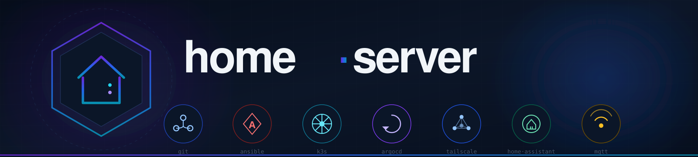

<p align="center">
  
</p>

<p align="center">
  <a href="https://ubuntu.com/server"></a>
  <a href="https://k3s.io"></a>
  <a href="https://argo-cd.readthedocs.io"></a>
  <a href="https://tailscale.com"></a>
  <a href="https://www.ansible.com"></a>
</p>

<p align="center">
  <b>Vollständig automatisierter, GitOps-getriebener Home-Server auf einer einzigen Maschine.</b><br/>
  Ansible provisioniert den Ubuntu-Host, k3s liefert Kubernetes, ArgoCD synchronisiert alles aus Git und Tailscale sorgt für Fernzugriff ohne offene Ports.
</p>

## Schnellstart

```bash
git clone https://github.com/Jaydee94/home-server.git && cd home-server

$EDITOR ansible/inventory/hosts.yml     # ansible_host = Server-IP
$EDITOR ansible/group_vars/all.yml      # argocd_repo_url, local_subnet, timezone

# Secrets als Inline-Vault-Werte in all.yml einsetzen, z. B. den Tailscale-Key:
ansible-vault encrypt_string 'tskey-auth-…' --name 'tailscale_auth_key'

make install
```

Am Ende gibt das Playbook die ArgoCD-URL und den Befehl zum Auslesen des Admin-Passworts aus. Eine frische Maschine richtest du zuerst nach [Ubuntu-Server-Installation](docs/00-ubuntu-server-install.md) ein, die Details zum Ablauf stehen in [Voraussetzungen](docs/02-prerequisites.md) und [Installation](docs/03-installation.md).

## Stack

| Schicht | Komponente |
|---|---|
| Host | Ubuntu Server 26.04 LTS, UFW, SSH nur per Key, `unattended-upgrades` |
| Kubernetes | k3s Single-Node mit Traefik v3, CoreDNS, local-path-provisioner |
| GitOps | ArgoCD mit ApplicationSet: jedes Verzeichnis unter `argocd/apps/` wird eine App |
| Netzwerk | Tailscale, MetalLB, Pi-hole als LAN-DNS (`*.homeserver`) und Adblocker |
| TLS | cert-manager mit eigener Homeserver-CA für alle Ingresses |
| Secrets | Ansible Vault (Host), Sealed Secrets und kubeseal-webgui (Cluster) |
| Monitoring | VictoriaMetrics, VictoriaLogs, Grafana, Alertmanager mit Push über ntfy |
| Automatisierung | Semaphore UI für Playbook-Läufe, Renovate für Versions-Updates |
| Backup | restic, nächtlich auf die UGREEN NAS |
| Anwendungen | Home Assistant, Mosquitto, Jellyfin, Media-Stack, Paperless-AI, Homepage, Gotify, Headlamp, Remedy, 7 Days to Die (KubeVirt), RPS-Arena |

Referenz-Hardware: Intel i5, 32 GB RAM, 512 GB NVMe. Paperless-NGX, Portainer und die Mediendaten liegen auf einer UGREEN NAS, die das Playbook `ansible/ugreen-nas.yml` verwaltet.

## Dienste

Alle Hostnamen löst Pi-hole im LAN und im Tailnet auf. HTTPS funktioniert, sobald das Gerät der Homeserver-CA vertraut ([Gotchas: TLS](docs/gotchas.md#tls--https)).

| Dienst | Adresse |
|---|---|
| Homepage | http://home.homeserver |
| ArgoCD | http://192.168.178.127:30080 |
| Grafana | http://grafana.homeserver |
| Headlamp, Semaphore, Gotify, ntfy | http://{headlamp,semaphore,gotify,ntfy}.homeserver |
| Pi-hole | http://pihole.homeserver/admin/login |
| Home Assistant, HA-MCP | http://homeassistant.homeserver, http://ha-mcp.homeserver/&lt;secret&gt; |
| Jellyfin | http://jellyfin.homeserver |
| Sonarr, Radarr, Prowlarr, SABnzbd, Seerr | http://{sonarr,radarr,prowlarr,sabnzbd,seerr}.homeserver |
| Paperless-AI, Remedy, kubeseal-webgui | http://{paperless-ai,remedy,kubeseal-webgui}.homeserver |
| Gameserver-UI | http://gameserver.homeserver |
| RPS-Arena | http://rps-arena.homeserver, http://192.168.178.127:30808 |
| Mosquitto | mqtt://192.168.178.4:1883 |
| Portainer, Paperless-NGX (NAS) | http://jays-ugreen:9000, http://jays-ugreen:8000 |

## Eine App hinzufügen

```bash
mkdir -p argocd/apps/my-app      # Helm-Chart, Kustomize oder Plain-YAML
git switch -c feat/my-app && git add argocd/apps/my-app
git commit -m "feat(my-app): add app" && git push -u origin feat/my-app
```

Nach dem Merge legt ArgoCD innerhalb von etwa drei Minuten die Application `my-app` im gleichnamigen Namespace an. Hat die App einen Ingress, gehört ihr Hostname in `ingressTls.hosts` in [`argocd/apps/cert-manager/values.yaml`](argocd/apps/cert-manager/values.yaml). Eigene Charts nutzen die Templates aus der Library [`argocd/lib/common`](argocd/lib/common/README.md). Mehr dazu in [ArgoCD](docs/05-argocd.md).

## Netzwerk und Sicherheit

Der Server hat keine öffentlich erreichbaren Dienste. Von außen geht alles über Tailscale, im LAN über Traefik und die MetalLB-IPs. SSH akzeptiert nur Keys, Secrets liegen verschlüsselt im Repo, und ArgoCD hat nur Lesezugriff auf Git.

| Port | Protokoll | Erreichbar aus | Zweck |
|---|---|---|---|
| 22 | TCP | LAN, Tailnet | SSH |
| 53 | UDP/TCP | LAN, Tailnet | Pi-hole auf `192.168.178.2` |
| 80, 443 | TCP | LAN, Tailnet | Traefik |
| 6443 | TCP | LAN, Tailnet | k3s-API |
| 30080, 30443 | TCP | LAN, Tailnet | ArgoCD-UI |
| 1883 | TCP | LAN | Mosquitto auf `192.168.178.4` |
| 41641 | UDP | Internet | Tailscale (WireGuard) |

## Updates

Jeder Playbook-Lauf spielt mit `auto_upgrade: true` die OS-Pakete ein, Sicherheits-Patches kommen täglich über `unattended-upgrades`. k3s, Helm, ArgoCD und alle Charts sind gepinnt, neue Versionen schlägt Renovate als PR vor. ArgoCD verwaltet sich selbst (`argocd/apps/argocd`) und rollt ein gemergtes Update ohne Ansible aus. Verlangt ein Update einen Neustart, startet der Host um 05:00 neu (`unattended_reboot_time`).

## Dokumentation

Einrichtung

- [Ubuntu-Server-Installation](docs/00-ubuntu-server-install.md)
- [Architektur](docs/01-overview.md)
- [Voraussetzungen](docs/02-prerequisites.md)
- [Installation](docs/03-installation.md)

Plattform

- [k3s](docs/04-k3s.md)
- [ArgoCD](docs/05-argocd.md)
- [Tailscale](docs/06-tailscale.md)
- [Pi-hole und DNS](docs/15-pihole.md)
- [NetworkPolicies](docs/23-network-policies.md)
- [Monitoring und Alerting](docs/13-monitoring.md)
- [Semaphore](docs/08-semaphore.md)
- [Backup](docs/26-backup.md)

Anwendungen

- [Scanner und Paperless](docs/10-scanner.md), [Paperless-AI](docs/12-paperless-ai.md)
- [Gotify](docs/11-gotify.md), [Homepage](docs/14-homepage.md)
- [Home Assistant](docs/17-homeassistant.md), [Nuki über MQTT](docs/18-nuki-mqtt.md), [HA-MCP](docs/22-ha-mcp.md)
- [Jellyfin](docs/16-jellyfin.md), [Media-Stack](docs/21-media-stack.md)
- [Gameserver](docs/19-gameserver.md), [Gameserver-UI](docs/20-gameserver-ui.md), [RPS-Arena](docs/25-rps-arena.md)
- [Remedy](docs/24-remedy.md)

Betrieb

- [Troubleshooting](docs/07-troubleshooting.md)
- [Gotchas](docs/gotchas.md)

## Lizenz

MIT, siehe [LICENSE](LICENSE).
