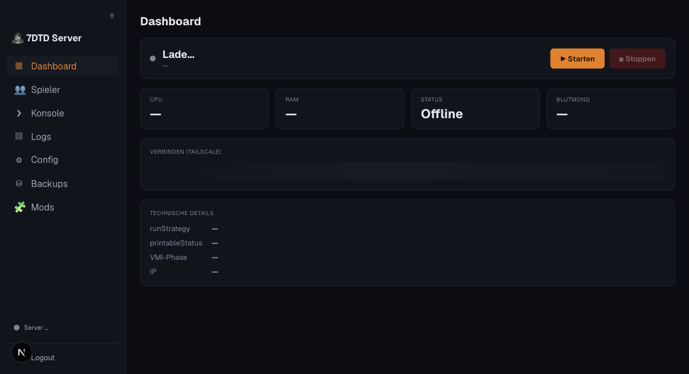

# Gameserver-UI

Eigene Next.js-App zum Verwalten des [7DTD-Gameservers](19-gameserver.md): VM starten und stoppen, Server-Config,
Konsole, Logs, Backups, Mods und Spieler.

| | |
|---|---|
| URL | http://gameserver.homeserver |
| Namespace | `gameserver-ui` |
| Quelle | App [`apps/gameserver-ui/`](../apps/gameserver-ui/) ([Entwickler-README](../apps/gameserver-ui/README.md)), Chart [`argocd/apps/gameserver-ui/`](../argocd/apps/gameserver-ui/) |
| Image | `ghcr.io/jaydee94/gameserver-ui`, gepinnt per Digest |
| CI | [`.github/workflows/gameserver-ui.yml`](../.github/workflows/gameserver-ui.yml) |



## Architektur

```text
Browser → Traefik → Service :80 → Pod :3000 (Next.js standalone, UID 10001, read-only rootfs)
  ├─ KubeVirt-API (Role im Namespace gameserver): VM get/list/patch, VMI get/list
  ├─ SSH als ubuntu zur VM-IP: docker, tar, unzip, Telnet-Tunnel auf Port 8081
  ├─ VictoriaMetrics :8428: CPU und RAM der VM
  └─ SMB-PVC gameserver-ui-data (//jays-ugreen/gameserver-data) → /mnt/gameserver-data (Backups)
```

| Funktion | Umsetzung |
|---|---|
| Starten, Stoppen | PATCH `spec.runStrategy` (`Always` bzw. `Halted`) |
| Neustart | `POST /api/restart`: bei Spielern online 30 s Vorwarnung, `saveworld`, dann `sudo docker restart 7dtd-server`. Die VM läuft weiter. |
| Spielversion | Telnet `version`, z. B. `V 2.6 (b14)` |
| Metriken | `kubevirt_vmi_vcpu_seconds_total`, `kubevirt_vmi_memory_resident_bytes`, `kubevirt_vm_resource_requests` |
| Backups | `tar` von `/opt/7dtd/data/Saves` auf den NAS, behält die neuesten 7 (`BACKUP_KEEP`); Restore stoppt den Container und legt den alten Stand als `Saves.pre-restore` ab |
| Mod-Upload | Zip als roher Body per SFTP auf die VM, `sudo unzip -o` nach `/opt/7dtd/mods`, maximal 100 MB (`MAX_MOD_UPLOAD_BYTES`) |

Login: ein Admin, Session per iron-session-Cookie. `ADMIN_PASSWORD` liegt im Klartext im Secret und wird
timing-sicher verglichen (SHA-256 beider Seiten, `timingSafeEqual`). Nach 5 Fehlversuchen pro Minute und IP antwortet
der Login mit `429`. Der Zähler liegt im Speicher und geht beim Neustart verloren. Zustandsändernde API-Routen prüfen
die Session zusätzlich selbst (`requireSession()`).

## Seiten

| Seite | Pfad | Inhalt | Screenshot |
|---|---|---|---|
| Dashboard | `/` | Status, CPU, RAM, Blutmond-Countdown, Version, Starten, Stoppen, Neustarten | [02](screenshots/02-dashboard.png) |
| Spieler | `/players` | Online-Spieler mit Session-Dauer, Broadcast an alle | [03](screenshots/03-players.png) |
| Konsole | `/console` | Telnet-Konsole | [04](screenshots/04-console.png) |
| Logs | `/logs` | Live-Log des aktuellen Container-Starts mit Suche, Pause, Kopieren, Download; Telnet-Verbindungen standardmäßig ausgeblendet | [05](screenshots/05-logs.png) |
| Config | `/config` | `serverconfig.xml` mit typgerechten Controls, Suche und XML-Expertenmodus; Speichern startet den Container neu | [06](screenshots/06-config.png) |
| Backups | `/backups` | Erstellen, Inhalt ansehen, Download, Restore, Löschen | [07](screenshots/07-backups.png) |
| Mods | `/mods` | Upload, Löschen, „Mods anwenden (Neustart)“; Stock-Mods (`0_TFP`, `TFP_`, `Xample_`) sind geschützt | [08](screenshots/08-mods.png) |

Die Config-Seite schreibt `/opt/7dtd/config/serverconfig.xml`. Damit das wirkt, muss die Datei vollständig sein und
auf `serverfiles/sdtdserver.xml` gemountet werden ([Gameserver: Fallstricke](19-gameserver.md#fallstricke)).

## Secrets

| SealedSecret | Keys | Pflicht |
|---|---|---|
| `gameserver-ui-auth` | `sessionSecret` (mind. 32 Zeichen), `adminPassword` | ja, sonst `CreateContainerConfigError` |
| `gameserver-ui-ssh` | `privateKey`, `publicKey`, optional `hostFingerprint` | ja; der Public Key gehört in die cloud-init-Userdata der VM |
| `gameserver-ui-smbcreds` | `username`, `password` | für Backups; ohne beide Werte entfällt der NAS-Mount |
| `gameserver-ui-telnet` | `password` | nein; nur nötig, wenn `TelnetPassword` in der Server-Config gesetzt ist |

Sealen, hier am Beispiel von `gameserver-ui-auth` (bei mehreren Keys im selben Secret immer denselben `--name`):

```bash
SESSION_SECRET=$(openssl rand -hex 32)
echo -n "$SESSION_SECRET" | ssh -i ~/.ssh/id_ed25519 jaydee@192.168.178.127 \
  'sudo kubeseal --raw --namespace gameserver-ui --name gameserver-ui-auth \
   --controller-name sealed-secrets-controller --controller-namespace sealed-secrets \
   --from-file=/dev/stdin'
# dasselbe für das Admin-Passwort
```

Die Ausgaben in [`values.yaml`](../argocd/apps/gameserver-ui/values.yaml) eintragen (`sealedSecret.encryptedSessionSecret`,
`sealedSecret.encryptedAdminPassword`, `sshSecret.*`, `smb.*`, `telnet.encryptedPassword`).

Ohne `hostFingerprint` prüft die App den Host-Key der VM nicht und warnt einmal pro Prozessstart. Der Wert ist der
SHA-256-Fingerprint als Hex ohne Doppelpunkte. Nach einer Neuinstallation der VM ändert er sich, dann schlagen alle
SSH-Verbindungen fehl, bis er aktualisiert ist.

## Image-Rollout

`image.tag` ist `stable@sha256:<digest>` mit `pullPolicy: IfNotPresent`, das Manifest benennt also genau ein Image.

1. Ein Merge nach `main` mit Änderungen unter `apps/gameserver-ui/` startet den Workflow: Type-Check, Lint, Tests,
   dann Build und Push von `sha-<short-sha>` und `stable`. Ausgerollt ist damit noch nichts.
2. Renovate (`helm-values`) sieht den neuen Digest hinter `stable` und öffnet einen PR für `values.yaml`.
3. Der Merge dieses PRs rollt das Image aus. Rollback: PR reverten.

Pull Requests bauen das Image nur zur Kontrolle und pushen nichts. Zum Pinnen von Hand steht der Digest in der
Zusammenfassung des Workflow-Runs.

## Betrieb

```bash
sudo kubectl -n gameserver-ui logs -l app=gameserver-ui --tail=50
sudo kubectl -n gameserver-ui rollout restart deployment gameserver-ui
sudo kubectl auth can-i patch virtualmachines -n gameserver \
  --as=system:serviceaccount:gameserver-ui:gameserver-ui    # erwartet: yes
```

## Fallstricke

- `502` auf `/api/vm` heißt meist fehlende RBAC: Role und RoleBinding liegen im Namespace `gameserver`, nicht im
  Namespace der App.
- Kappt der Client einen Telnet-Socket abrupt, stirbt 7DTDs Writer-Thread, und der nächste Befehl zeigt
  `IOException … socket has been shut down`. `telnetCommand` (`src/lib/telnet.ts`) meldet sich deshalb mit `exit` ab
  und filtert Logzeilen per `extractCommandOutput()`. Taucht der Fehler auf, diese beiden Stellen prüfen.
- Mod-Upload mit `502 sudo: unzip: command not found`: `unzip` fehlt in der VM. Lädt 7DTD den Mod nicht, fehlt der
  Bind-Mount `/opt/7dtd/mods` (siehe [Gameserver](19-gameserver.md#fallstricke)).
- `/api/mod-upload` ist vom Middleware-`matcher` ausgenommen, damit Next.js den Body nicht komplett im RAM puffert.
  Die Route prüft die Session selbst; größere Mods per `scp` nach `/opt/7dtd/mods` kopieren.
- `/api/version` und der Neustart liefern `502 "Telnet timeout"`, wenn `TelnetPassword` gesetzt ist und nicht dem
  Secret `gameserver-ui-telnet` entspricht.
